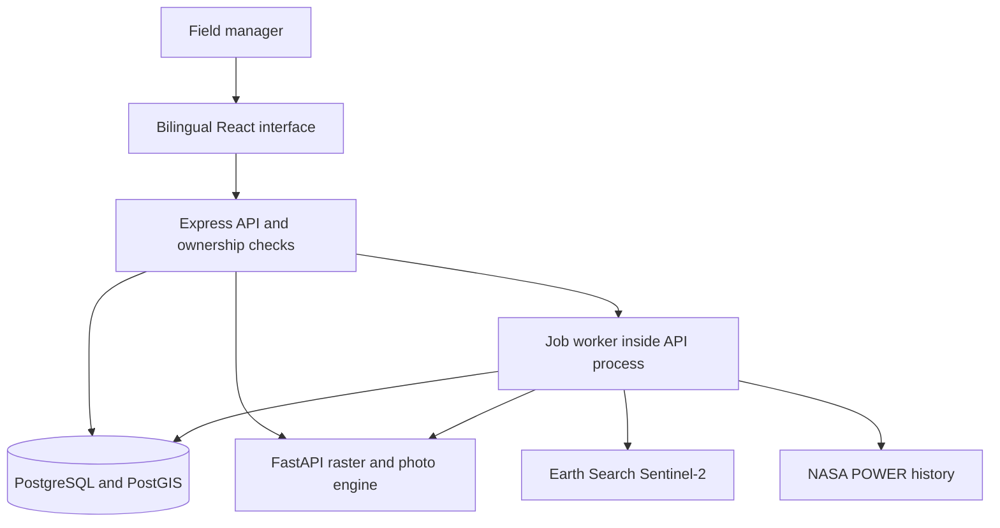
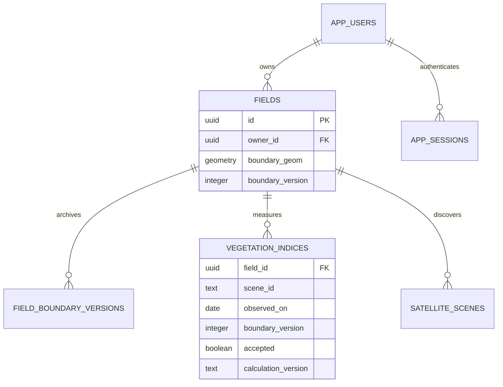
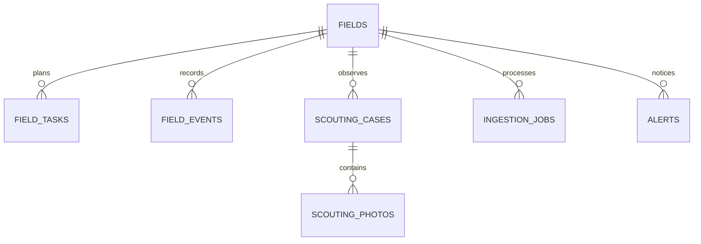

# CHM design and requirement traceability

Verified against the current React/Express/PostgreSQL/PostGIS/FastAPI implementation on 16 October 2026. These diagrams describe implemented components, not an assertion of external provider uptime or agricultural accuracy.

## Components

Leaflet/OpenStreetMap supplies the interactive basemap; it is not the Sentinel acquisition. Gemini is the credential-dependent crop assistant. An independent forecast provider and automatic disease classifier are not implemented.

## Ownership and evidence data model

Observation identity includes field, scene, observed date and boundary version. Current assessments use accepted measured imagery for the current boundary. The stored experimental score is separate from image coverage.

## Field work data model

Photos are stored privately and accessed through owned API routes. Jobs have attempts, status, heartbeat and lease token; they run inside the existing API process. Tasks/alerts record user actions; resolving them does not establish biological recovery.

## Requirements and executable evidence

| Requirement | Owning implementation | Verification |
|---|---|---|
| Field save independent of imagery, optional dates | AddFieldWizard, fieldsController | actions.spec.ts; field-workflows.spec.ts |
| Missing/stale evidence is not healthy/unhealthy crop | shared/evidence.ts; fieldCopy.ts; Dashboard | evidence.test.ts; plain-language.spec.ts |
| Same-date images preserve exact selected scene | FieldMap | field-workflows.spec.ts |
| Boundary editing versions evidence | fieldsController; boundary migrations | satellite.integration.test.ts; actions.spec.ts |
| Understandable next step and demo-only recovery | Dashboard; FieldOverview; Help | plain-language.spec.ts |
| Hindi/English, acres/hectares and mobile layouts | preferences; index.css | farmer-workspace.spec.ts; responsive.spec.ts |
| Visit creation/retry identity and status | tasksController; FieldOverview | farmer-workspace.spec.ts; satellite.integration.test.ts |
| Photo upload preserves notes and states no diagnosis | FieldHistory; scoutingController; engine image inspection | scouting.spec.ts; engine tests |
| Owned field/data access | auth middleware and routes | auth.spec.ts; owner integration case |
| Queue deduplication, recovery and stale-boundary handling | services/jobs.ts | jobs integration case |
| Versioned quality-aware raster processing | services/satellite.ts; engine/main.py | satellite.integration.test.ts; engine/test_evidence.py |
| Dated trends and controlled comparison | FieldAnalysis; VegetationChart | evidence.spec.ts; engine tests |
| CSV/GeoJSON and browser print report | FieldReport; shared/exports.ts | exports.test.ts; farmer-workspace.spec.ts |

Frontend test files are under `tests/ui`; backend tests are under `backend/api`; Python tests are under `backend/engine`. Browser APIs/tiles are fixtures. PostGIS CI uses actual database transactions with controlled engine responses. Neither establishes live satellite acceptance or diagnosis accuracy.

The WBS, methodology, risk register and schedule remain in [Phase II planning](PHASE_II_PLANNING_DESIGN.md). Current checks, performance environment, remaining gaps and demo script are in [Submission readiness](SUBMISSION_READINESS.md).
