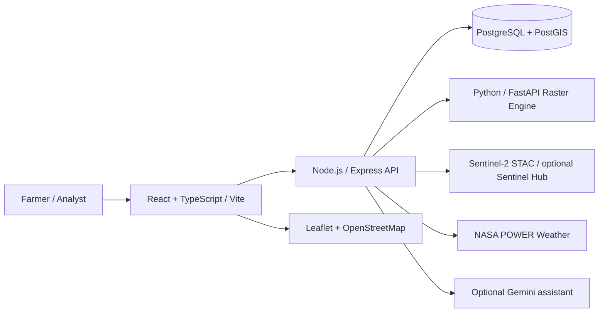

# Phase II — Planning & Design (10 marks)
**Project:** TerraScope Crop Health Monitor (CHM)  
**Rubric period:** 17 August–12 September 2026  
**Status:** Design, WBS, risk register and requirement traceability prepared; actual guide sign-off remains pending.

## 1. Problem and design goal
Farm-level satellite observations and weather information are difficult for non-technical users to interpret. TerraScope aims to turn field boundaries, Sentinel-2 observations, vegetation indices and weather records into accessible field-level views. Satellite indices are indicators, not diagnoses of disease or yield.

## 2. Methodology
Incremental development: requirements → architecture → field/data workflows → implementation → unit/integration/UI tests → stakeholder feedback → revision. Maintain traceability from each requirement to its implementation and test evidence.

## 3. Architecture

This diagram represents components described in the repository README, not a claim that every external integration has been tested live.

## 4. Work Breakdown Structure
| ID | Work package | Deliverable | Verification |
|---|---|---|---|
| W1 | Requirements and feasibility | Scope and constraints | Guide review |
| W2 | Architecture and data model | Component diagram, schema overview | Design walkthrough |
| W3 | Field management | Boundary, CRUD, ownership | API/UI tests |
| W4 | Satellite and vegetation pipeline | Scene discovery, raster/index results | Controlled fixtures and live evidence |
| W5 | Weather and health interpretation | Weather view, trends, explanatory text | Data-source checks |
| W6 | Usability | Plain-language dashboard and responsive layouts | Farmer/user task testing |
| W7 | Quality assurance | Unit, integration, UI and smoke tests | Logs and reports |
| W8 | Delivery | Demo, report, poster, viva | Guide sign-off |

## 5. Schedule and milestones
- Phase I: initiation and literature/feasibility (reported completed by student).
- Phase II: design review and WBS (this document).
- Mid-term: prototype demonstration and preliminary results (verify faculty outcome).
- Phase III: implementation, tests and performance evidence by 24 October 2026.
- Exhibition: working demonstration and poster, 26–31 October 2026.
- Final evaluation: report, viva, research/IPR as applicable, early–mid November.

## 6. Risks and mitigation
| Risk | Impact | Mitigation |
|---|---|---|
| Cloud-covered Sentinel scenes | Incomplete imagery | Display acquisition/cloud metadata; do not imply fresh imagery |
| Missing/irregular observation dates | Misleading trend | Date-aware trend calculation; indicate data gaps |
| External API downtime | Failed sync | Timeouts, bounded retries, user-visible status |
| Missing PostGIS/dependencies | Demo failure | Preflight setup and offline fixture demonstration |
| NDVI interpreted as diagnosis | Misleading recommendations | Explain uncertainty and need for ground inspection |
| Sensitive field locations | Privacy risk | Ownership, authentication and controlled deployment |
| Non-technical dashboard | Poor usability | Task-based labels, legends, definitions and user tests |

## 7. Bill of Materials / resources
Software: Node.js 24, Python 3.11, PostgreSQL/PostGIS, React/Vite, Express, FastAPI, rasterio, Leaflet/OSM; satellite data from Sentinel-2 and weather from NASA POWER. Hardware: development laptop and internet; optional GPS-capable phone for field mapping. **No procurement costs or hardware purchases are claimed.**

## 8. Progress review and sign-off
Attach dated guide meeting notes, architecture approval, design feedback and screenshots. **Guide sign-off: pending.** Do not backdate signatures or claim unverified milestones.

## 9. Evidence checklist
- [ ] Architecture diagram exported to image/PDF
- [x] Data model/schema diagram: [Design and traceability](DESIGN_AND_TRACEABILITY.md)
- [ ] Screenshots of field creation and dashboard
- [ ] Guide feedback record
- [ ] Design review presentation
- [x] Requirement-to-test traceability with verification limits: [Design and traceability](DESIGN_AND_TRACEABILITY.md)

**Source:** Major Project Evaluation Rubrics — B.Tech. Pre-final Year 2026–27, Phase II (10 marks).

Current implementation/test evidence and immediate submission gaps: [Submission readiness](SUBMISSION_READINESS.md).
